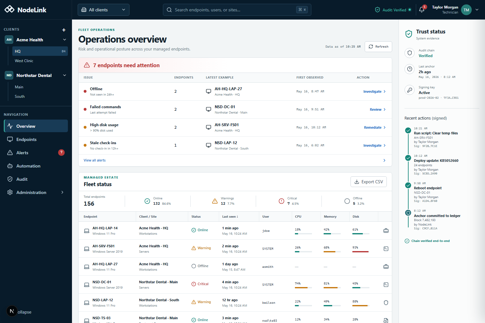

# NodeLink RMM

[](https://github.com/lcolon231/rmm-agent/actions/workflows/ci.yml)
[](LICENSE)


**A self-hosted remote monitoring and management (RMM) platform for IT teams
that look after Windows fleets in regulated industries, built from scratch as
a solo full-stack project.**

An RMM is the tool an IT provider uses to watch over and fix hundreds of
customer machines without visiting them: see what is installed, run a script,
patch Windows, restart a server, open a remote shell. Most RMM products are
heavy to deploy and keep thin records of who did what. NodeLink is designed
around the opposite priorities: every remote action is cryptographically
signed, endpoints only ever connect outward, and the administrative audit trail
is tamper-evident and independently verifiable.



## At a glance

| | |
| --- | --- |
| **What it is** | Three deployable parts: a Go agent that runs as a Windows service, a Python/FastAPI server on PostgreSQL, and a Next.js technician dashboard |
| **Size** | ~130,000 lines of Go, Python and TypeScript across 3 services, 49 design and operations documents |
| **Tests** | 719 Python tests, 323 Go tests, 33 dashboard test suites, all run in CI on every push |
| **CI** | Linux and Windows Go builds, a real Windows service install/start/stop/uninstall lifecycle, the Inno Setup installer, a disposable PostgreSQL migration test, dashboard lint/typecheck/test/build, licence and release-target checks |
| **Releases** | 12 tagged releases (`v0.1.0` to `v0.1.11`) shipping SHA-256 checksums, an SPDX SBOM and signed build-provenance attestations |
| **Status** | Early stage and Windows-first. Working end to end, not yet approved for production or regulated endpoints |
| **Author** | [Luis Colon](https://github.com/lcolon231) |

## What it does

- **Fleet visibility.** Hardware, installed software, Windows Defender,
  BitLocker, Secure Boot, TPM and local-administrator inventory, with change
  history and diffs. Unchanged machines send no inventory bytes.
- **Monitoring and alerting.** Scoped policies for CPU, memory, disk, service
  and pending-reboot checks, alert state with maintenance-window suppression,
  and delivery by email or signed webhooks.
- **Remote actions.** PowerShell and shell execution, an interactive remote
  shell, file and registry remediation, service and process control, audited
  restart and shutdown, and bounded Windows event-log queries.
- **Patching and software.** Windows Update scan and install with approval
  policies and compliance reporting, Winget and Chocolatey package management,
  and MSI/EXE deployment with mandatory integrity checks.
- **Automation.** An immutable, versioned script library with typed
  parameters, and cron-style scheduled tasks.
- **Operator security.** Roles, tenant-scoped authorization, WebAuthn
  multi-factor authentication, two-person approval for sensitive commands,
  break-glass emergency access and full session management.
- **Audit and compliance evidence.** A hash-chained audit log with Merkle
  anchors that can be published to immutable storage, plus signed,
  deterministic evidence packages that an auditor can verify offline.
- **Agent lifecycle.** Signed, staged agent self-update with automatic
  rollback, loss-safe credential renewal, quarantine and revocation.
- **End-user support.** A system-tray launcher that opens a consent-gated
  support chat with a technician, and an audited MeshCentral remote-desktop launch (shipped disabled by default pending live verification).

## Engineering highlights

These are the parts of the codebase that best show how it was built.

- **Signed command protocol shared across two languages.** Every command is an
  Ed25519-signed envelope with an expiry and a nonce. The Go agent and the
  Python server validate against the same canonical test vectors in
  `contracts/`, and the agent rejects anything missing, malformed, expired,
  replayed or downgraded. Key rotation is staged with overlap and has a
  documented compromise-response path.
- **Fail-closed by default.** Arbitrary script execution is denied even to
  administrators until an explicit, audited grant exists. Production startup
  refuses to run with debug mode, placeholder secrets or non-HTTPS URLs.
  Collection failures are reported as "unavailable", never as an empty
  healthy result, so a permission error can never read as "nothing is
  encrypted".
- **Reliability under bad networks.** Command results are encrypted into a
  durable on-disk outbox and retried idempotently across outages, lost
  acknowledgements and restarts. On Windows, commands run inside
  kill-on-close Job Objects so a timeout or service stop always terminates the
  whole process tree.
- **Self-update that cannot brick an endpoint.** The agent verifies the new
  binary's digest and size, backs itself up, swaps atomically, restarts, and
  commits only after a successful authenticated check-in. Otherwise it restores
  the previous build on its own. A failure rate above the release's threshold
  halts the rollout.
- **Tamper-evident audit trail.** Audit events carry hash-bound monotonic
  sequence numbers in a hash chain. Periodic Merkle anchors can be published to
  S3 Object Lock or a WORM filesystem, and clean-room verifiers check the chain
  and the receipts without trusting the server.
- **Two-person authorization done at the database.** An approval binds the
  hash of the exact command, approver eligibility is re-checked at dispatch,
  and the one-verdict-per-identity rule is a database constraint rather than
  application logic. A justified emergency override exists for policies that
  opt in: single-use, minutes-long, notified at activation, and reviewed
  afterwards by someone else.
- **Operational safety has its own tests.** Forward-only Alembic migrations
  are enforced at startup, and CI rehearses an incompatible bad release, an
  exact-revision encrypted backup restore and audit re-verification.
- **Honest documentation.** The architecture document is the source of truth
  for what is and is not implemented, security-sensitive changes must ship
  with tests and documentation in the same pull request, and the README never
  claims more than the code delivers.

## Architecture

```text
Technician browser ── Next.js dashboard ── JWT ──▶ FastAPI server ──▶ PostgreSQL
                                                        ▲
                                                        │ outbound HTTPS only
Windows endpoint ── Go agent (Windows service) ─────────┘
                    heartbeat + poll; signed commands come back in the response
```

Endpoints never accept inbound connections. The agent polls outward, and
signed commands ride back in the heartbeat response. TLS is terminated by a
reverse proxy (Caddy in the documented topology, or Render's proxy for the
hosted blueprint), never by the application.

| Component | Stack | Where |
| --- | --- | --- |
| Endpoint agent | Go 1.22, Windows service, DPAPI-protected identity | [`agent/`](agent/) |
| Server | Python 3.12, FastAPI, SQLAlchemy 2, Alembic, PostgreSQL | [`server/`](server/) |
| Dashboard | Next.js 16, React 19, TypeScript, same-origin API boundary | [`dashboard/`](dashboard/) |
| Installer | Inno Setup, tested in CI on a Windows runner | [`installer/`](installer/) |
| Deployment | Caddy reverse proxy, encrypted backup and restore, soak-test harness, Render blueprint | [`deploy/`](deploy/), [`render.yaml`](render.yaml) |
| Contracts | Versioned schemas and shared Go/Python canonical vectors | [`contracts/`](contracts/) |

## Where to look first

If you have ten minutes, these files show the core ideas:

| Topic | File |
| --- | --- |
| How the agent verifies a signed command | [`agent/internal/verify/verify.go`](agent/internal/verify/verify.go) |
| How the server builds the command envelope | [`server/app/core/command_envelope.py`](server/app/core/command_envelope.py) |
| Hash-chained audit log and Merkle anchors | [`server/app/core/audit.py`](server/app/core/audit.py), [`server/app/core/anchor.py`](server/app/core/anchor.py) |
| Two-person approval for sensitive commands | [`server/app/core/approvals.py`](server/app/core/approvals.py) |
| Justified emergency override of an approval policy | [`server/app/core/emergency_overrides.py`](server/app/core/emergency_overrides.py) |
| Agent self-update with automatic rollback | [`agent/internal/selfupdate/`](agent/internal/selfupdate/) |
| Security analysis | [`docs/threat-model.md`](docs/threat-model.md) |
| Design source of truth | [`docs/ARCHITECTURE.md`](docs/ARCHITECTURE.md) |

## Current status

NodeLink is an early-stage project and is honest about it. The first three
delivery milestones (deployment safety, Windows RMM MVP, patching and
remediation) are delivered or nearly so, and the fourth (compliance
productization) is under way. It is not approved for production or regulated
endpoints and does not claim HIPAA compliance. The two remaining gates before a
controlled pilot are Authenticode code signing and a recorded multi-day soak
run.

The full feature-by-feature inventory, including what is explicitly not built
yet, is in [docs/PROJECT-STATUS.md](docs/PROJECT-STATUS.md). The phased plan is
in the [roadmap](docs/ROADMAP.md), and pilot gates are tracked in the
[deployment-readiness checklist](docs/DEPLOYMENT-READINESS.md).

## Running it locally

Each component has its own quick start:

- [Server](server/README.md): Python 3.12, generates signing keys, creates the
  first administrator, runs under uvicorn.
- [Agent](agent/README.md): build with Go, enroll against a server, optionally
  install as a Windows service.
- [Dashboard](dashboard/README.md): Next.js app that talks to the server
  through a server-side API boundary.
- [Windows installer](installer/README.md): Inno Setup package for the agent.

End-to-end enrollment runbooks, the API reference and release notes live under
[`docs/agent-enrollment/`](docs/agent-enrollment/).

## Repository layout

```text
rmm-agent/
├── agent/       # Go endpoint agent and Windows service integration
├── server/      # FastAPI API, persistence layer and migrations
├── dashboard/   # Authenticated Next.js technician and administrator UI
├── installer/   # Inno Setup Windows installer
├── deploy/      # Reverse proxy, backup/restore and soak-test tooling
├── contracts/   # Versioned schemas and shared Go/Python canonical vectors
├── docs/        # Architecture, security, roadmap and operations documents
├── tools/       # Licence and release-target validation helpers
└── .github/     # CI, release automation and contribution templates
```

## Contributing

Work is organised through phased GitHub milestones and issues.
Security-sensitive changes require tests, and architecture and security
documentation must be updated in the same pull request as the behaviour
change. See [CONTRIBUTING.md](docs/CONTRIBUTING.md).

## License

NodeLink RMM Community Edition is licensed under the GNU Affero General Public
License v3.0 only. See [LICENSE](LICENSE). Commercial licensing may be offered
separately. The NodeLink name, logos and branding are not licensed under the
AGPL; see [TRADEMARKS.md](TRADEMARKS.md).

SPDX-License-Identifier: AGPL-3.0-only
